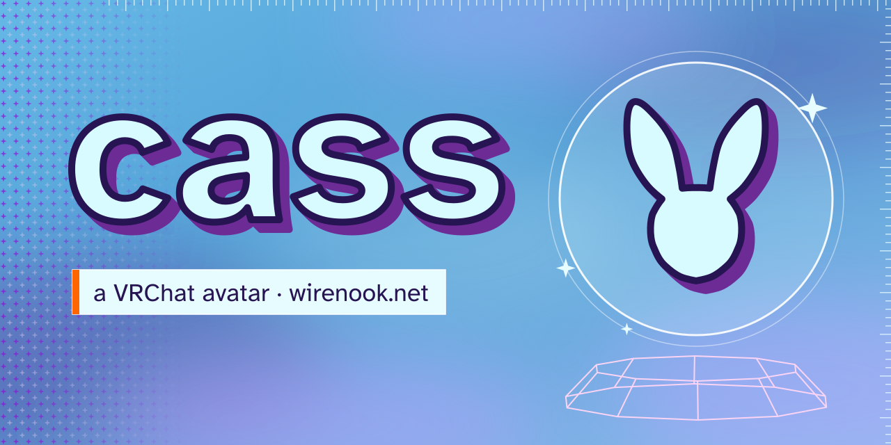

# cass

Cassidy's VRChat avatar, built as a pipeline rather than a scene: the model
comes out of Blender, everything Unity needs is generated from it and from a
handful of spec files, the optimising happens at build time on a throwaway
copy, and uploads fill in their own metadata.

The model is a kitbash, and is itself generated: a CC0 body base
(SiroinoSotai) and a CC0 face (HENGE's Mizunashi Hiyori), with the hair,
rabbit ears, tail and outfit modelled in code around them. See
[Credits](#credits).

## How it fits together

```
blender/sources/ (body base, face) ─┐
blender/scripts/kitbash/ (hair,     ├─build─▶ blender/cass.blend, cass-lite.blend
  ears, tail, outfit, texture)     ─┘                 │ export, verified
                                                      ▼
                         Packages/net.wirenook.cass/BlenderExports/cass.fbx, cass-lite.fbx
                                        │  import rules applied in code
Spec/*.json ───────────────────────────▶│
                                        ▼
                         generated materials, FX animator, menus
                                        ▼
        Prefabs/cass-root.prefab        the one root avatar prefab (a variant of the model)
                    ▼
        Prefabs/Variants/cass-lite.prefab   the one for tight performance (on the root, not on cass)
        Prefabs/Variants/cass.prefab        everyday upload
                    ▼
        Prefabs/Variants/cass-adv.prefab    adds flight, stations, hand tools and what a group needs
        Prefabs/Variants/cass-flashlight.prefab, cass-lantern.prefab   one real light each (extend cass)
        Prefabs/Variants/cass-contacts.prefab   the contact toys and the shape collector (extends cass)
        Prefabs/Variants/wirenook-bot.prefab    another avatar altogether, on a root of its own (net.wirenook.bot)
        Prefabs/Variants/meta.prefab            a third, the hooded game master (net.wirenook.meta-avatar)
                    ▼  at build time, on a copy
        lite model where asked ▶ Modular Avatar ▶ wirenook-assets ▶ Avatar Optimizer ▶ measured, checked, uploaded
```

| Path | What it is |
| --- | --- |
| `blender/` | The source assets, the generator that builds `cass.blend` and `cass-lite.blend` from them, and the headless scripts that validate and export those. |
| `Packages/net.wirenook.cass/` | The avatar, as a VPM package. `Spec/` holds the contracts, `BlenderExports/` the one place exports land, `Editor/` the generators, `Generated/`, `Materials/` and `Prefabs/` their output. |
| `Packages/net.wirenook.bot/`, `blender/bot/` | A second avatar on the same pipeline, and the generator of its model. See [The robot](#the-robot). |
| `Packages/net.wirenook.meta-avatar/`, `blender/meta/` | A third: a hooded game master with nothing in the hood, the base of the avatars that run a game or watch one, and the generator of its model. See [The game master](#the-game-master). |
| `modules/` | Nine standalone packages the avatars build on, as git submodules, each with its own repository, version and README; and beside them the world, a Unity project of its own. |
| `Assets/` | The validation scene and development tools. Not shipped. |
| `tools/`, `art/` | The thumbnail composer, contact-sheet composer and banner. |

### The standalone packages

| Submodule | Package | What it provides |
| --- | --- | --- |
| [`wirenook-assets`](https://github.com/CassidyPrather/wirenook-assets) | `net.wirenook.assets` | The shared palette, materials, menu icons, sounds and the editor helpers the others build with. |
| [`locomotion`](https://github.com/CassidyPrather/locomotion) | `net.wirenook.locomotion` | Procedural locomotion generated from a gait model, collider flight, a stepladder for a lifted play space, and a standing nap while away. |
| [`world-sync`](https://github.com/CassidyPrather/world-sync) | `net.wirenook.world-sync` | Leaving props in the world, with their position synced for late joiners: one at a time, or many on a shared bus. |
| [`avatar-stations`](https://github.com/CassidyPrather/avatar-stations) | `net.wirenook.avatar-stations` | A carry seat, a catch-up portal, and seats for a group in a ring or facing a screen. |
| [`adventure-tools`](https://github.com/CassidyPrather/adventure-tools) | `net.wirenook.adventure-tools` | Laser pointer (with a ping), megaphone, flashlight, lantern, screen notices, a beacon; an invisible switch; presence: who sees you and who hears you, decided for each person in the room; and a game master's kit: dice, a pause, zone markers, a pointer, a portal and a skeleton key. |
| [`party-tricks`](https://github.com/CassidyPrather/party-tricks) | `net.wirenook.party-tricks` | A bonk hammer, a vanishing act, a mosaic censor, a busy sign, the crash and the vanish for when you are away, and the shape collector: a collect-the-shapes course laid out in any world from the avatar (the pilot for world-sync's bus). |
| [`contacts`](https://github.com/CassidyPrather/contacts) | `net.wirenook.contacts` | VRChat contacts put to use. A kit on the standard contact tags: reactions to each, a tester that emits each and launches things, a shield that burns, targets to set down. And skill checks, one set of rules for worlds and avatars: the right tags touch a thing for long enough and it happens. Their avatar demo is a campfire, a match and a marshmallow. |
| [`selective-animation`](https://github.com/CassidyPrather/selective-animation) | `net.wirenook.selective-animation` | Things an avatar does for only some of the people looking at it: whoever its wearer points at and marks (one raycast against the viewer's own collider, after VRLabs' Selective Animation), or whoever carries the same circle. With a reticle, a latch, and a probe for testing it in a client. No variant carries it yet. |


[`wirenook-world`](https://github.com/CassidyPrather/wirenook-world) is
mounted beside them and is not a package: it is the wirenook.net world, a
Unity project of its own with the Worlds SDK, generated, played and checked
from the command line. Avatar pedestals, a stall for each package here, a
contact lab, light rooms, a render-queue gallery, Cassidy's grill, and a
puzzle dungeon built on the skill checks of `contacts`. Its README says what is in it and
how to build it; nothing here opens it.

**A package for both targets.** `contacts` serves worlds as well as
avatars. Each side of it is an assembly that only compiles where what it
needs is installed (a version define and a define constraint on the SDK
and on the packages it builds with), so the one package imports cleanly
into an avatar project and into a world project. The price is that it can
name neither SDK as a dependency: its README says what each side needs,
and whoever installs it adds those. `scripts/compile-check.py` reads the
same fences. Two packages were folded away on 2026-11-26 rather than keep
more of them that way: `skill-checks` into `contacts`, and
`shape-collector` in two halves, the avatar's game into `party-tricks`
(which stays an avatar package, with its dependencies declared) and the
world's course into `contacts`, since it is made of nothing but skill
checks.

They are mounted as submodules and referenced in place
(`Packages/manifest.json` points at `modules/<repo>/Packages/<id>`), so one
checkout edits everything in one Unity project. Someone installing the
avatar from a VPM listing gets them as ordinary dependencies instead.

## Getting started

```bash
git clone --recurse-submodules https://github.com/CassidyPrather/cass-avatar
```

Requires Unity 2022.3.22f1 through a VPM client (prefer
[ALCOM](https://vrc-get.anatawa12.com/en/alcom/)), Blender 5.0, Python
3.11+ with Pillow and numpy, and the [.NET SDK](https://dotnet.microsoft.com/download)
11 for the headless checks.

Add these listings to your VPM client once, then add this folder as a
project and open it in Unity:

| Listing | For |
| --- | --- |
| `https://vpm.nadena.dev/vpm.json` | Modular Avatar, NDMF |
| `https://lilxyzw.github.io/vpm-repos/vpm.json` | lilToon |
| `https://vpm.anatawa12.com/vpm.json` | Avatar Optimizer |

## Everyday commands

These talk to the Unity editor you already have open; nothing needs to be
closed or restarted.

```bash
scripts/cass.sh build             # sources + modelled parts -> blender/cass.blend, cass-lite.blend, and each other wardrobe's
scripts/cass.sh export            # Blender -> BlenderExports/cass.fbx, cass-lite.fbx, and each other wardrobe's, validated
scripts/cass.sh rebuild           # regenerate materials, animators, menus, prefabs
scripts/cass.sh verify cass       # build the variant as an upload would, and check it
scripts/cass.sh verify cass android   # the same for another platform's build
scripts/cass.sh sheets cass       # contact sheets in dist/validation/cass/
scripts/cass.sh preview cass      # what an upload would send to VRChat
scripts/cass.sh platform android  # switch the editor to pc, android or ios
scripts/cass.sh upload cass       # build and upload for the editor's platform
scripts/cass.sh upload '.*' all   # every variant (a regex over slugs) for every platform
scripts/cass.sh live cass         # what VRChat holds for the uploaded variant
scripts/cass.sh publish cass      # send name, description, tags, visibility only
scripts/cass.sh retire cass-party # delete a deprecated variant's avatar from VRChat, for good
scripts/cass.sh bundle            # inspect the bundle the SDK built last
scripts/cass.sh all               # export, rebuild, verify every variant on every platform
```

The same things are in Unity's menu under `Tools > Wirenook`.

## The model contract

Blender validates these on export and Unity builds from them, so each name
is written down once, in `Packages/net.wirenook.cass/Spec/`.

- **`skeleton.json`**: one armature shared by every outfit, variant and
  fidelity level, mapped to Unity's humanoid bones by name. Its extra
  bones say what they are for: the body base's arm twist helpers name the
  bone they follow, and the first bone of each physics chain (ears, tail,
  hair, skirt) names its PhysBone settings. A chain that carries one
  garment also names that garment's UV tile, and `colliders` lists the
  capsules along the legs that keep the skirt's chains off them. A bone
  with `follow` is turned part of the way with a limb by a constraint (the
  skirt's two lifts, with the thighs), and a chain marked `pcOnly` has
  physics that Android and iOS builds leave out.
- **`blendshapes.json`**: the shapes the `Body` mesh (the head) carries.
  - the 15 VRChat visemes (`vrc.v_*`);
  - VRChat's native face-tracking keys (Unified Expressions names, 102 in
    SDK 3.10.6), each tagged with a face region and whether it is required;
  - 44 MMD shapes under their Japanese names. MMD worlds find them on a
    mesh that must itself be called `Body`, directly under the avatar root.
- **`uv-tiles.json`**: toggles as UV tile discard. Every face carries a
  second UV set that only says which toggle group it belongs to, and the
  shader drops whole groups. A garment lists the body zones it covers, and
  a zone is drawn only while nothing covers it, so skin cannot clip through
  clothing and a hidden zone costs nothing to draw. A tile's switch is a
  rule: the value of its parameter that shows it, what else it needs and
  what it gives way to. The shorts give way to the skirt, the vest is only
  shown over the sweater it is fitted to, and the short and the long hair
  are one switch. A switch can name the value it `rests` at where its
  tile's resting state does not say (the shorts rest hidden under the
  skirt with their switch on), and a tile marked `"mobile": false` rests
  shown on PC and is cut from Android and iOS builds, which have no room
  for it. The grid is four by four, the most the shader has, and
  every tile is now in use. It is one float per
  group on the material rather than a renderer per toggle, which is what
  lets the whole avatar be one mesh and one material slot.
- **`proportions.json`**: the figure is scaled to its `height` and stands
  `bootHeelHeight` off the ground. The other measurements described the
  placeholder; the body base's own proportions now stand in for them.

The model exists at two fidelity levels with the same objects, bones,
blendshapes and UV tiles: `cass.fbx` (about 58,700 triangles) and
`cass-lite.fbx` (about 18,900, of which 16,300 are shown at rest), which
uses the body base's low-polygon mesh and coarser modelled parts. The prefabs hold the full one; a build takes the
lite meshes instead for Android and iOS, and for any variant that asks.

How the model is built, what was changed about the source assets and the
contracts a hand-made replacement has to keep are in
[`blender/README.md`](blender/README.md).

### Textures

There is one texture, `Textures/cass-atlas.png`, baked by the model build.
It holds the face's painted texture (recoloured: blue eyes, brown lashes
and brows) and, beside it, the flat colours of
`Textures/cass-palette.toml` as solid cells. Everything but the head and
the skirt is flat-coloured: every face maps to the centre of one cell, so nothing is
mirrored and mip-mapping cannot bleed. The body's skin cell is sampled from
the face texture, so the two match. The body keeps its own UVs in a
skin-coloured corner of the atlas. The skirt's gingham is a painted patch
that repeats every two centimetres, and each of the skirt's faces is laid on
it at one scale.

A second texture with the same layout, `Textures/cass-atlas-normal.png`,
carries the face's and the body base's own normal maps and is flat
elsewhere. Both sources are meant to be shaded through them: without the
face's, toon shadow creases around the mouth.

Detail that a texture would carry is geometry instead: stitching, seams,
pockets, belt loops, lacing and trims are thin strips and patches laid a
couple of millimetres above the surface (`kitbash/detail.py`), at the full
level only.

Materials are lilToon with no minimum brightness (in a dark world the
avatar is dark), and lilToon's Clipping Canceller is switched on for the
project so a face seen from very close is pushed back rather than cut open.
The avatar's material adds, in `CassMaterials.Look`: an outline coloured
from the texture under it (darker and a little more saturated, never plain
black), a faint rim light with a matching rim shade, and a softer, shorter
shadow than the props use.

## Gestures and face tracking

`Spec/gestures.json` is Cassidy's learned layout, one expression per
gesture per hand:

| Gesture | Left hand | Right hand |
| --- | --- | --- |
| Fist | Sleepy Content | Happy |
| Open | Sleepy Sad | Sleepy Happy |
| Thumbs up | Flummoxed | Excited |
| Finger gun | Afraid | Sad |
| Point | Angry | Smug |
| Peace | Hungry | Wink 1 |
| Rock | Heart Eyes | Wink 2 |

One expression shows at a time: while the right hand holds one, the left
hand's layer rests, so two recipes are never laid over each other.
Expressions are recipes over the shapes above, not extra blendshapes.

**With a face tracker.** The tracking keys are split into three blendshape
sets, eyes, brows and mouth, and each expression says which of those it
*owns*. While a tracker is live, holding a gesture fades out only the sets
it owns and animates only those regions; the tracker keeps the rest. Sleepy
Content closes your eyes while your tracked mouth goes on talking. Heart
Eyes and the scribbled Afraid eyes work the same way.

**Without one**, or with the menu's Face Tracking switch off, the sets stay
at zero, gestures animate the whole face, and an animated blink runs. It
pauses while a gesture owns the eyes, so a wink is never blinked through.

The gesture layers are FX layers 1 and 2, the two MMD worlds silence, and
they are the only layers that touch the MMD-named shapes.

**Ears and tail.** An expression can also name a `pose` from the same file:
perked, spread, relaxed, drooping, pinned back, or one ear cocked for a
wink. A pose turns the ear and tail bones, given per bone as degrees
forward, outward and of twist about the avatar's own axes. A layer of its
own reads both hands (the right hand wins when its expression has a pose),
so it keeps working in MMD worlds and with a face tracker. The ears bend
from the base: the first bone takes most of each turn. They pass through
holes in the hat's brim just above their roots, though, so `posesWhile`
gives a second set for while the hat is worn, which bends them higher up
and barely moves the base; the layer follows the hat's switch. Their
PhysBones swing around whatever pose is held, and may swing furthest at
the base too.

**A hand that is busy makes no face.** A feature that uses a hand's
gesture as a button says so with a `WirenookHandClaim`
(`net.wirenook.assets`): the laser pointer that pings on a fist, and
anything that is aimed before it is set down (below). While such a
feature's parameter is on, and afterwards until that hand has relaxed or
1.2 s have passed, the expressions, the blink, the tracking hand-over and
the ear poses all read that hand as making no gesture, so a trigger pull
that places a portal is not also a grin. The other hand's expressions go
on working. The generator finds the claims on every feature a variant
lists and gives the avatar one small layer per claimed hand, after the two
gesture layers.

**Away.** Every avatar shows that its wearer is away, and has an "AFK"
switch at the top of its menu to say so by hand (`WN/Away`); VRChat's own
AFK (a headset taken off, the system menu, the End key) does the same.
There are three ways of showing it, and a variant has one, named by `afk`
in `Spec/variants.json`:

| `afk` | What the avatar does | Feature | Which variants |
| --- | --- | --- | --- |
| `nap` | Stands asleep, nodding off, eyes shut, ears hanging, Zs rising from the head. | `Wirenook Nap` (`net.wirenook.locomotion`) | The ones with nothing to spare: `cass-lite`, `cass-gaits`, `meta`. And the Android and iOS builds of every variant that vanishes. |
| `crash` | Locks where it stands, tears and glitches, its eyes small blue error screens, an error window reading AFK beside it, a device-unplugged cue and a buzz. | `Wirenook Away` (`net.wirenook.party-tricks`) | The machine and the cyber wardrobe: `wirenook-bot`, `cass-cyber`, `cass-quickhack`. |
| `vanish` | Goes up in a puff of smoke and leaves a log standing where it was; comes back in another puff. | `Wirenook Away (Vanish)`, which works the vanishing act of the party tricks | Everything else: `cass`, `cass-adv`, `cass-flashlight`, `cass-lantern`, `cass-contacts`. |

The packages' READMEs have the whole of each. The avatar adds things of
its own to all three, in layers that already owned those shapes and bones
(the blink and the poses) and are outside the two that MMD worlds
silence: the ears hang; the eyes stop blinking and, for the crash, each
becomes a small blue error screen with a sad face, or shut for the nap,
which says it is napping through an animated parameter
(`WirenookSignals.Asleep`). The screen is the toon shader's
(`net.wirenook.assets`), drawn on the faces of the eyes' UV tile; where on
an eye its picture goes is written into the model's third UV set as it is
imported (`CassModelImporter`).

A variant cannot take off a feature of the variant it extends, and
`cass-cyber` extends `cass`. So the features of every flavour a variant's
line has named stay on its prefab, the variant's root says which one it
wants (`WirenookAfkChoice`, with a second choice for Android and iOS), and
the build leaves the others out, keeping their expression parameters in
place so that the list is the same everywhere (`net.wirenook.assets`). The
checks fail a variant that builds with no way of being away, with two, with
another than its `afk` says, or without exactly one "AFK" switch at the top
of its menu.

The switch cannot mute the microphone, because VRChat gives an avatar no
way to. `modules/party-tricks/tools/away_mic.py`, run beside VRChat with
OSC enabled, does it from outside for all three flavours (it listens for
`WN/Away`), and unmutes on return only if the mute was its own and nothing
has touched the microphone since.

## Variants and uploads

`Spec/variants.json` lists the upload variants. Each is a prefab variant of
the root prefab, or of another variant, with feature prefabs added as
children.

| Variant | Rank on PC | What it is |
| --- | --- | --- |
| `cass-lite` | Good | The one for where performance is tight: the low-polygon model on PC too, locomotion, the Face Tracking switch, the Outfit menu, and the nap while away. Nothing else, and nothing is to be added. |
| `cass` | Good | Everyday, and what the rest start from: the full model, locomotion baked for this avatar's own skeleton, vanishing while away (a nap on Android and iOS), the party tricks (a bonk hammer, a vanishing act that leaves a log behind, a mosaic censor for the head or the whole body, a busy sign) and the outfit shuffle. |
| `cass-adv` | Medium | For going out and for leading a group: everything `cass` has, and flight, a stepladder for a lifted play space, a carry seat, a catch-up portal, four seats to put down in a ring or facing a screen, a laser pointer that can ping the spot it points at, a megaphone, a flashlight and a lantern, screen notices, and a beacon that shows where the wearer is through walls. |
| `cass-flashlight`, `cass-lantern` | Poor | `cass` with the adventure kit and one real light: a spotlight in the flashlight, or a point light in the lantern, which can be placed in the world. They carry that one tool and not the other. A light ranks an avatar Poor and a second Very Poor, hence one each. On mobile the tool is there without its light. |
| `cass-contacts` | Medium | For playing with contacts: everything `cass` has, everything in `net.wirenook.contacts` (it reacts to VRChat's standard contact traits, and carries the tester, the shield that burns and the targets), and the shape collector. One avatar to clone for both halves of a test. PC only. |
| `cass-shuffle` | Medium | `cass` with the outfit shuffle taken as far as it goes: each viewer's roll can also dress her from the cyber wardrobe, or stand the robot in her place. PC only. See [The shuffle, with guests](#the-shuffle-with-guests). |
| `cass-gaits` | Good | A sampler for choosing how the avatar walks: every walk style of the locomotion package, with a Walk style menu to switch between them in game. PC only, and not a variant of `cass`. See below. |
| `cass-cyber` | Good | `cass` in the cyber wardrobe: a techwear jacket with lit seams, a utility vest, a pleated skirt with a lit hem, chunky boots and a headset in place of the hat. It crashes while away where `cass` vanishes. See [Wardrobes](#wardrobes). |
| `cass-quickhack` | Very Poor | The cyber build carrying Quick Hack by DiNe Shop, a bought prop that is not in this repository. PC only, uploaded private, and only made where the prop has been imported. See [Assets that are not in the repository](#assets-that-are-not-in-the-repository). |
| `wirenook-bot` | Good | Not cass at all: a low-poly robot with a sprite face, carrying the same drop-in features. See [The robot](#the-robot). |
| `meta` | Excellent | Not cass either: a low-poly game master in a hooded robe with nothing in the hood, and trim in a colour its wearer chooses. The base for the avatars that run a game or watch one, kept light enough to rank Excellent on every platform. See [The game master](#the-game-master). |
| `meta-spectator` | Good | `meta` as a ghost, for watching a game: it loads seen and heard by nobody but the people backstage (everyone wearing this or a game master's avatar, who see each other as spectres in their own colours), and its wearer chooses from there who sees them and who hears them. Flight on PC. Good on Android and iOS too. See [The spectator](#the-spectator). |
| `meta-dm` | Medium | `meta` with what it takes to run a scene, behind one menu entry: dice rolled for everyone or in secret, a pause, three zone markers and a two-ended portal set down in the world, a light and a laser on the fingertip, a skeleton key for contacts, notices for a table. With presence (it loads seen and heard by all), flight and a seat to carry someone on. Medium on Android and iOS too. See [Running a scene](#running-a-scene). |
| `meta-dm-crypt` | Poor | `meta-dm` made over for one adventure, as an example of doing that: zones that are hot, cold or windy, a danger zone that warns before it strikes, a barricade that hands take apart or fire burns, a chest that opens once its key is found, a swinging blade and a rift that hands seal, all laid out behind the scenes and made live with one switch. PC only. See [One module's game master](#one-modules-game-master). |
| `meta-probe` | Good | Not for wearing: `meta` with five lamps over its head that show what each viewer's client worked out, to find out in a VRChat client whether the mechanisms under the spectator work. PC and Android (Medium there). See [The spectator](#the-spectator). |

### How much a variant carries

There were twelve variants, most of them `cass` with one more thing, and
which one to wear was a question with too many answers. The rule now:

- **What a variant carries goes by the rank it is held to and what it is
  for.** `cass-lite` carries nothing it can do without. A variant held to
  Good carries every reusable feature that fits at Good. A variant that is
  Medium anyway (the placed props of `cass-adv` are meshes of their own,
  which nothing can help) carries everything that is of use to it, and
  does not try to stay at Good.
- **A feature that costs a platform its rank is left out there, not
  everywhere.** A feature in `variants.json` can be marked `pcOnly` for
  one variant: `cass` leaves the tricks and the shuffle out of its Android
  and iOS builds, where they would take it from Medium to Very Poor, and
  keeps their parameters so that the list is the same on every platform.
  On mobile, `cass` is therefore `cass-lite`.
- **Two things are on every variant, by rule.** The "AFK" switch, with
  whichever of the three ways of being away the variant names, and the
  "Invisible" switch (`Wirenook Unseen`, `net.wirenook.adventure-tools`):
  one synced bit and one animator layer, with no component, so it costs
  no variant its rank, `cass-lite` included. Neither is listed under a
  variant's `features`; the spec adds them, and `verify` fails a build
  without them.
- **Features share what they can.** The build keeps one audio source for
  every feature whose sounds are short cues from the avatar itself
  (`WirenookSharedSound`), where each used to bring its own; signs (the
  AFK window, the contact reactions) are geometry in the avatar's own
  mesh and material and take turns in it; hand-held props join the
  avatar's mesh as before. What cannot be shared is a thing left standing
  in the world, which has to be a mesh of its own with its own slots.

| Was | Is now | Why |
| --- | --- | --- |
| `cass-party` | `cass` | The tricks fit beside the everyday build at Good. |
| `cass-event` | `cass-adv` | It was `cass-adv` with more; `cass-adv` now has all of it and is Medium, as this was. |
| `cass-shapes` | `cass-contacts` | The shape collector is a contact game, and lives with the others. |

Those three are listed under `deprecated` in `Spec/variants.json`, with
the avatar ids they were uploaded under. Their prefabs are gone from the
repository. `scripts/cass.sh retire <slug>` takes a deprecated variant's
avatar down from VRChat; it refuses anything that is not on that list.

`cass-shuffle` was a fourth, folded into `cass` when the shuffle became a
switch in the Outfit menu. It is back, on the avatar id it always had,
because the shuffle grew past what `cass` can carry at Good; `cass` keeps
the shuffle it had.

**The Outfit menu** has five switches, each with an icon of its own: the
boots, the hat, a tiered gingham skirt, an open vest with a neckerchief
worn over the sweater, and long hair in place of the short. The skirt and
the vest rest on and the hat rests off, so the avatar as it loads is the
design in the reference art but for the hair.

A garment with nothing under it has no switch. The body base is a doll
body with no underwear layer, so `uv-tiles.json` marks the torso and the
hips as zones that have to stay covered (`cover`), and the menu offers a
switch only where no combination of the offered switches could bare one
(`TileLayout.Offered`). The sweater is all there is over the torso, so it
stays on. Two garments cover the hips; the shorts give way to the skirt,
so they are the layer that stays, and the skirt's switch chooses between
the two. Boots come off, because bare feet are just bare feet. The rule is
worked out from the tiles, so a wardrobe that gains something to wear
underneath (a swimsuit over the same zones) gets its sweater and shorts
switches back without anything else changing. A switch that is not offered
is not synced either.

**Shuffle**, the menu's last entry on `cass` and what builds on it, makes
the avatar change its outfit whenever a viewer looks away from it and
back. Each viewer's client rolls for itself; nothing but the switch is
synced, and no two people need see the same outfit. It lays its outfit
over the wearer's own choices through a layer whose weight the switch
sets, so switched off it changes nothing. PC only: the outfits are UV
tiles.

#### The shuffle, with guests

`cass-shuffle` is `cass` with a fuller shuffle
(`Cass Outfit Shuffle (Guests)`, generated by `BotShuffle` in
`net.wirenook.bot`, the package that knows both avatars). It is a joke,
and is priced like one. Besides the ten outfits `cass` rolls between, a
viewer's roll can be:

- **Something from the cyber wardrobe**, in seven outfits: all of it, with
  and without the headset, the jacket over the gingham skirt, the sweater
  over the cyber skirt and boots, and so on. A wardrobe is otherwise a
  different avatar, its garments the same meshes on the same UV tiles;
  here the cyber garments ride along as a mesh of their own, so that an
  outfit can take each garment from either. They are the low-polygon
  ones: with the full ones the avatar would pass 70,000 triangles and be
  Very Poor.
- **The robot**, three rolls in twenty. Cass is gone altogether, hidden
  tile by tile like any garment, and `wirenook-bot` stands in her place.
  The two skeletons name their bones alike and Modular Avatar merges an
  armature by name, so each of the robot's bones becomes hers: every
  rigid piece of it sits at her joint and turns as her limb turns. It is
  the robot drawn out to her build, with gaps where her limbs are longer
  than its own and a tangle where her fingers are, and it walks, sits and
  waves exactly as she does. Its face works: the expressions follow the
  hands, it blinks, and its mouth follows speech, from an FX layer on
  VRChat's `Viseme` parameter, since VRChat itself only moves an avatar's
  own face.

Both guests are on the avatar all the time and hidden the way outfits
are: their materials are copies that rest with the tiles hidden, and a
layer of the feature's own shows what a roll wears. With the switch off
that layer shows nobody, and the Outfit menu rules as it does on `cass`.
Nothing more is synced than `cass` syncs. A variant cannot take off the
shuffle `cass` carries, so the feature says it replaces it
(`WirenookReplaces`) and the build leaves the plain one out.

What it costs, `cass-shuffle` against `cass`, both built for PC:

| | `cass` | `cass-shuffle` | Limit for Good |
| --- | --- | --- | --- |
| Performance rank | Good | Medium | |
| Skinned meshes | 2 | 4 | 2 |
| Material slots | 7 | 10 | 8 |
| Triangles | 61,662 | 69,363 | 70,000 |
| Bones | 113 | 114 | 150 |
| Texture memory | 8.3 MB | 8.8 MB | 75 MB |
| Download (packed here, see below) | 3.54 MB | 3.68 MB | |
| Synced bits | 85 | 85 | 256 |

Nothing else that is ranked moves (phys bones, colliders, contacts,
animators). Two things make it Medium: two more skinned meshes (the robot's face, and
its shell together with the cyber garments) and three more material slots
(the three copies). Neither can be had for less while the guests are
meshes of their own, which is why this is a variant and not a part of
`cass`. The triangles are the tight one: 637 are left before Very Poor,
so nothing with geometry can be added to this variant, and the party
tricks it inherits from `cass` are counted in that. The download grows by
0.14 MB; the sizes are from packing each build into an asset bundle here
(`BundleSize` in the harness: Unity's packing, not the SDK's), so they
are for comparing, and the upload's own may differ.

What is fragile about it:

- While a viewer has the robot, anything the build joined to cass's own
  mesh is hidden from that viewer with her: the bonk hammer, the busy
  sign, the smoke of the vanishing act. They sit on the UV tile that is
  never otherwise hidden. The log the vanishing act leaves is a mesh of
  its own and stays.
- The robot roll hides cass by giving weight to a second layer
  (`Shuffle Bare`) one frame after the outfit layer has changed, so for
  that frame her head and hands may show beside the robot.
- Avatar Optimizer merges the robot's shell with the cyber garments. That
  is harmless only because the two are hidden through different tiles;
  a guest that used a tile the other uses would show and hide with it.
- The cyber garments are the low-polygon ones over the full body. They
  were looked at standing; where they do not quite meet the skin has not
  been hunted for.

**The skirt** is cloth on physics, carried by the legs. It hangs on ten
chains of three bones, jointed at the seams between its tiers. The four
chains in front of the thighs hang from two lifts, one at each hip joint,
that a rotation constraint turns half of the way with its thigh; the six
round the sides and back hang from a root that stays with the hips. A knee
that comes up therefore takes its cloth with it at once, however fast it
comes: left to physics alone, a quick knee went straight through. Three
PhysBones do the rest, each chain on a hinge that lets it swing straight
out from the body or back in, with capsules along the upper and lower legs
to push them: sitting lays the cloth over the thighs, and a heel kicked
back lifts the hem behind. A stride swings the front of the skirt with it,
by half the thigh's angle. The PhysBones are switched with the skirt and
are not simulated while the shorts are worn.

### The robot

`wirenook-bot` is a second avatar built by the same pipeline, there to
show that what cass carries is not cass's: the features are dropped onto
it unchanged. It also turns up on cass's own skeleton, as a guest in
`cass-shuffle` (see [The shuffle, with guests](#the-shuffle-with-guests)).

It is a low-poly humanoid, 2,105 triangles, with blocky pixel textures on
one atlas, five jointed fingers on each hand, and rabbit ears and a tail
projected in light from emitters on its head and back. Its model is
generated by `blender/bot/` (its README has the contract) and lands in
`Packages/net.wirenook.bot/BlenderExports/bot.fbx`.

**The face is sprites.** The head is a monitor, and each eye shape, mouth
shape and overlay is a quad that rests hidden inside the head and is
brought to the screen by a shape key (`Spec/face.json` lists the 96). So
the things VRChat and MMD worlds animate by name still work: the fifteen
visemes are mouth sprites, each MMD shape shows the sprite nearest to
what it means, and a blink is a sprite. `Spec/expressions.json` says
which sprites make each of the expressions the hands choose; the gestures
are cass's own, so the same hand makes the same face on either avatar. While the wearer is
away the screen shows a bluescreen.

**How it joins the pipeline.** `BotBuild` generates the robot's own
materials, FX controller, menu and root prefab, and is marked
`[AvatarRootBuilder]`, which is all `scripts/cass.sh rebuild` needs to
call it. Its variant in `Spec/variants.json` names that prefab as its
`root`, and from there it is built, checked, pictured and uploaded like
any other; the checks that are about cass's model (its blendshapes, the
MMD contract of its mesh) are skipped for it. Its humanoid bones go by
cass's `skeleton.json`, whose bone names it shares.

**What it carries**: a way of moving of its own (below), the crash while
away with its AFK window and sounds, the party tricks, and the campfire
from the skill checks of
[`contacts`](https://github.com/CassidyPrather/contacts): a fire
to set down that a match lights and water puts out, and a marshmallow
that toasts over it, burns if it is left, and can be eaten. The features
that were there before it were not changed to fit it.

The face is a mesh of its own (`Body`) and everything else is another
(`Shell`): Avatar Optimizer keeps a mesh with blendshapes apart from the
rest, so props and signs join the shell. On Android and iOS the hologram
is drawn with the body's material, solid where on PC it glows, which
keeps the avatar at two material slots; the tricks and the campfire are
left out there.

**How it moves.** Not like a person: `Prefabs/Bot Locomotion.prefab`
replaces the Base and Additive layers with the robot's own, and the
package's walk is not on it. The motions are written in
`Editor/BotMotion.cs` and laid out over velocity by
`Editor/BotLocomotion.cs`; `net.wirenook.locomotion` bakes them on the
robot's skeleton and supplies the state machine, which is VRChat's default
one (`CustomLocomotion` there).

- **Standing**, it does not move at all. At a desktop a forearm ticks up
  and back now and then, one after the other, and the knees take up their
  slack: each at one speed, stopping dead.
- **Walking**, it has one clock. A cycle of two steps takes half a second
  at every speed and only the length of the step changes. A foot holds the
  ground for half the cycle, then goes straight up, straight across and
  straight down. The body rides level, lower the longer the steps; the
  arms are bent square and change places at each footfall. It steps ahead
  and back up to 2.2 m/s, and sideways up to 0.6 m/s, which is as far as
  one foot clears the other.
- **Sliding** is what it does where its legs cannot keep up: sideways from
  1.4 m/s and ahead or back from 3.1 m/s it is off the ground, legs
  locked and toes down, the whole body tipped as one piece toward where it
  is going, arms swept back (or out, sideways). VRChat's walk, strafe and
  run are 2, 2 and 4 m/s, so on a keyboard it walks ahead and back, slides
  sideways and slides when it runs. A thumbstick passes through the
  mixtures between.
- **Crouched**, the same two at a squat. **Lying down**, it holds VRChat's
  own still pose and slides: it has no crawl.
- **In the air**: going up it is straight as a rocket, toes pointed; coming
  down the knees bend and the arms go out; a long drop spreads everything.
  **Landing**, the knees take it at once and it comes back up in two
  notches.

It costs nothing in rank and is the same on every platform: there are no
objects, parameters or sounds in it. `LocomotionPlay` in the harness
plays it on the built variant and measures the feet. The Base controller
is 13 MB of keys, so a rebuild bakes it only when the model, the motions
or the locomotion package have changed (`Generated/Locomotion/baked-from.txt`).

It went up private at first (`unreleased` in its variant) and was made
public on 2026-11-26: that line taken out, `scripts/cass.sh rebuild`,
then `scripts/cass.sh publish wirenook-bot`. The `meta` variants went
the same way a day later.

### The game master

`meta` is a third avatar on the pipeline, and the base of the ones that
run a game or watch one: a low-poly figure in a hooded robe, 1.75 m, with
nothing in the hood. No face, no visemes, no shape keys; one mesh, one
material, one 256 px atlas, 1,878 triangles. Its model is generated by
`blender/meta/` (its README has the contract) and lands in
`Packages/net.wirenook.meta-avatar/`, where `MetaBuild` makes the rest
and is marked `[AvatarRootBuilder]` like the robot's. The package is not
called `net.wirenook.meta`: Unity takes a folder whose name ends in
`.meta` for the meta file of a folder that is not there, and says so on
every refresh.

It is kept as light as an avatar gets, so that the performance filters of
people who have never seen it let it through. Built, it ranks
**Excellent on PC, Android and iOS**, and costs 10 synced bits. All it
carries is the dial for its colour, the nap while its wearer is away and
the invisible switch every avatar has.
Variants for particular jobs extend it; what they add is theirs to
account for.

**The head that is heard is not the head that is seen.** A player's voice
and nameplate follow the humanoid head bone, and avatars built on this
one will move that bone away on purpose, for some viewers, to go unheard
by them. So the humanoid `Head` carries no weights and nothing hangs off
it in the model. The hood is on `HeadVisual`, a bone beside it under the
neck in the same place, which a rotation constraint makes turn as `Head`
turns (the turn, not the place) and a `VRCHeadChop` hides from its own
wearer, since VRChat only shrinks `Head` itself in first person. Its root says so (`WirenookFreeHead`,
`net.wirenook.assets`), and the build then sends whatever a feature
mounts on the head bone (the nap's Zs) to `HeadVisual` instead, so that
it stays where the head is seen. `meta` itself never moves `Head`;
[the spectator](#the-spectator) does.

**The signature colour.** The trim, the runes, the gems and the tips of
the index fingers are painted in one cyan, and the wearer turns a dial
("Colour", in the menu) to turn its hue. The convention is not this
avatar's but `net.wirenook.assets`'s, so that tools from other packages
can follow the same colour: one synced, saved float (`WN/Signature`, 8
bits), one material property (`_WirenookSignature`) that the build drives
on every renderer whose material has it, and a mask on `Wirenook/lilToon`
that says which texels are painted so. On Android and iOS the build draws
such a material with VRChat's Toon Standard, whose masked hue shift is the
same arithmetic, and drives that; the two come out alike
(`SignaturePreview`). The package's README has the whole of it.

**What else is its own.**

- The hood's point and the lobe of each cuff sway on PhysBones, three
  components over four bones, with no collision and no grabbing. They sit
  under one object marked PC-only; Android and iOS leave it out and the
  figure is rigid there.
- It naps while away. The nap is a humanoid pose, so the hood nods.
- It has no hand expressions, and its FX controller is three empty
  layers: the two that MMD worlds silence are kept in their places so
  that features are merged in after them, as on every avatar here.
- Avatar Optimizer's MMD world compatibility is off for it. That setting
  keeps a mesh called `Body` apart from everything else, for worlds that
  animate a face by that name; here there is no face, and it would cost
  the rank a second skinned mesh as soon as a prop joined the avatar (the
  nap's Zs). The checks only ask that a mesh called `Body` survives a
  build where the variant's own `Body` has shape keys.
- VRChat still writes `Viseme` and `Voice` for it (lip sync is set to
  parameters only), for a feature that wants to answer to the wearer's
  voice.

The mantle is a bib that hangs from the chest and a cap on each shoulder
that belongs to the upper arm alone, so a raised arm lifts its cap and
does not come through it (before 2026-11-27 it did; the model's validator
now poses the arms eleven ways and fails on a sleeve through the mantle).
Weak, and seen in pictures only: an upper arm twisted more than about 45
degrees while it hangs pulls a corner of its cap through the back of the
sleeve; the robe is joined trouser legs, which widens in a long stride
and stretches in a deep crouch.

### The spectator

`meta-spectator` is `meta` carrying **presence**
(`net.wirenook.adventure-tools`, on `net.wirenook.selective-animation`):
its wearer chooses who sees them and who hears them, and each viewer's
own client works out which side of each choice it is on. It loads as a
ghost.

- **Shown to** and **Heard by** are each one of everyone, backstage only,
  or chosen people. Five pairs have a menu entry of their own: Everyone,
  Ghost (backstage for both), Narrate (heard by all, seen by none),
  Whisper (heard by the chosen) and Appear (seen and heard by the chosen).
- **Backstage** is everyone whose avatar carries presence: spectators,
  and the game masters to come. They always see and hear each other.
  Someone who is hidden from the room is drawn for them, and for
  themself, as a spectre in their own signature colour, so that a crowd
  backstage can tell at a glance who the players cannot see.
- **Chosen people** are whoever the wearer points at and marks (aim with
  the head, hold Mark until the reticle shows a green disc).
- **Not shown** is the invisible switch's layer, told by presence: no
  renderer of the avatar is drawn on that client. **Not heard** moves the
  humanoid head bone two thousand kilometres up on that client, and the
  nameplate goes with the voice; this is what `meta`'s empty head bone is
  for. The avatar's root is marked `WirenookFreeHead`, the build sends
  what features mount on the head (the nap's Zs, the selector's eye) to
  `HeadVisual`, and nothing is left under `Head` to be carried off.
- **It rests undrawn.** Where its animations do not run (a viewer's safety
  settings), and for a tenth of a second after it loads, nobody sees it.
  Pictures of it here are of a copy with the renderers switched back on.

It ranks **Good on PC, Android and iOS** (one mesh on each; the
selector's two raycasts keep it from Excellent, and on PC the flight's
collider does too) and costs 19 synced bits: `meta`'s 10, presence's 8
and the flight's 1. Flight is PC only, as
everywhere.

`meta-probe` is `meta` with the probe of `net.wirenook.selective-animation`:
five lamps over the head, each lit separately on each viewer's client.
Two people wearing it find out in two minutes whether the pointer finds
one viewer, the latch keeps them, the circle knows its own and parameter
drivers run on other people's copies (that package's README has the
steps). It is the first thing to wear, before the spectator: presence
rests on the first three.

The package's README has presence in full, including what it costs to be
unheard this way: it leans on where VRChat happens to put a voice, which
VRChat may change, and hiding a nameplate is something to check against
VRChat's rules before doing it anywhere people have not agreed to it.

`PresencePreview.Render <slug>` (through `scripts/unity-bridge.py invoke
Wirenook.Validation.Editor.PresencePreview.Render`) writes what each kind
of viewer is drawn to `dist/validation/presence/<slug>/`.

### Running a scene

`meta-dm` is `meta` carrying **the game master's kit** of
`net.wirenook.adventure-tools`, with presence (the plain one: it loads
seen and heard by everyone, and is backstage with the spectators),
flight, and the carry seat of `net.wirenook.avatar-stations`. Everything
below is behind one "Game Master" entry in the menu and in the wearer's
signature colour.

- **Dice.** A coin, 1d6, 2d6, 1d20, 2d20. The wearer's client draws the
  numbers and syncs them; everyone near is shown them on a board over the
  wearer's head that reads from both sides, or, rolled in secret, the
  wearer alone on a board of their own (and the people backstage, if the
  wearer says so). A public roll shows whether or not the wearer does.
- **Pause.** One press drops a ring where the wearer stands, sized by a
  dial (other people see a turn of it a second or two later: the sizes
  ride the bus, below), with a pause sign over it and a sound. On PC the inside is dimmed
  (the game master excepted) and everyone whose eyes are inside has a
  card on their screen saying so.
- **Zones.** Three spheres to aim and set down, each sized by a dial and
  shown to everyone or to backstage only: a ring of dashes and two
  arches everywhere, and on PC a dashed line lying on whatever the
  sphere's edge crosses and a faint tint inside, drawn with stencil
  volumes, so with no depth texture and no light on the avatar.
- **Pointer.** A glow on the index fingertip, on with the pointing
  gesture or a switch, and a laser from it. It is also what things are
  aimed with.
- **Portal.** A door anyone can click and, set down separately, where it
  leads; with no second end it leads to the wearer, for whoever was left
  behind.
- **Skeleton key.** Sends any one of VRChat's nineteen trait tags by
  touch and shows which it feels. PC only: it is twenty contacts.
- **Notices** for a table ("Scene starts", "Roll for initiative", ...).
  PC only, as the everyday ones are.

What stands in the world (the pause, the zones, both ends of the portal)
rides one anchor bus of `net.wirenook.world-sync`, so six things sync
what one position costs, and a late arrival has them all within one round
of it. The bus also carries a value for each thing, which is where the
four sizes travel: eight synced bits between them, where a synced float
each was thirty-two. A thing is aimed with the finger, set down with a fist, measured,
read out ahead of the bus's round and only then switched on, about two
seconds after the click: nobody is shown it where it used to stand. The
kit's two meshes are made in code and stand apart from the wearer's
figure, so a game master who has gone unseen keeps their zones.

It ranks **Medium on PC, Android and iOS**, and has to stay clear of Very
Poor: a game master hidden by someone's performance filter spoils the
scene.

| | PC | Android, iOS |
| --- | --- | --- |
| Triangles | 14,308 | 7,440 |
| Skinned meshes | 3 (Medium) | 2 (Medium) |
| Material slots | 10 (Medium) | 2 (Medium) |
| Contacts | 21 (Medium) | 1 |
| Raycasts | 3 | 3 (Medium) |
| Bones | 79 | 66 |
| Synced bits | 136 | 136 |

On PC three things each hold it at Medium, so none is worth giving up
alone: a third skinned mesh for the shapes that need the kit's own
shaders, ten material slots, and the key's contacts. On mobile it is two
skinned meshes in two materials, which is all Android and iOS allow
before Very Poor: nothing more that is a mesh of its own can be added
there, which is why the carry seat is left out of those builds. The 136
synced bits are the kit's 116 (the bus is 65 of them), `meta`'s 10,
presence's 8, flight's 1 and the seat's 1; 120 are left for a game master
made for one module, which is the same kit built with more tools in its
list (the package's README has how, and
[the next section](#one-modules-game-master) is one).

Not done: the megaphone, set aside for now; and the seat is the one cloud
of `avatar-stations`, not several.

### One module's game master

`meta-dm-crypt` is `meta-dm` made over for one adventure, a module called
The Sunken Crypt that exists only to be an example. Its kit is the plain
kit with one more tool in the list (`CryptTool`, in
`Packages/net.wirenook.meta-avatar/Editor/Crypt`), built with nothing but
the kit's public parts, the skill checks of `net.wirenook.contacts` and
VRChat's standard contact tags. The prefab names the plain kit as what it
replaces, so the variant can extend `meta-dm`. Under "Game Master ▸
Crypt":

- **Zones that are hot, cold or windy.** A ring of dashes in the
  element's colour, with embers rising, flakes falling or streaks of air
  going round inside it, a faint tint over everything in it, and a
  contact sender with the trait (`Hot`, `Cold`, `Wind`) filling it. An
  avatar with the contact reactions of `net.wirenook.contacts` says HOT!
  in one; anything of anybody's that listens for those tags does what it
  does. 0.75 to 3 m: VRChat allows a contact three metres of radius, and
  a zone that looked bigger than it acts would be a lie.
- **A danger zone** that shows where it will strike before it does: a
  dark disc spreads from the middle for two seconds, and when it fills
  the ring the ground jabs up and the zone carries `Damage` and
  `DamageBlunt` for a third of a second. Once, or over and over. Nothing
  in it glows, flashes or is red.
- **A barricade** of five planks. Ten seconds of hands on it take it
  apart from the top, a plank at a time, and it keeps what has been done
  when it is let go; fire does the same and it burns meanwhile. It stays
  down for everyone once it is down.
- **A chest with a padlock, and its key**, set down separately wherever
  it is to be found. A hand on the key takes it, for the whole party.
  Until then the padlock rattles under a hand; after, it gives and the
  lid goes back.
- **A pendulum**: a blade on a long arm, hung from a pivot wherever the
  game master sets it (it has no frame of its own), carrying `Damage`
  and `DamageSharp` through its swing. Everyone sees it swing in step.
- **A rift**: a tear in the air, the way paper tears. A tall ragged gash
  hangs there with the torn edge of the world curled back round it in
  flaps, white on the side that was hidden, and scraps of the sheet
  drifting about it. It is not a flat cut-out: the gash is a crumpled
  body with two faces and an edge, so it has a shape from the side, and
  it is a window from behind as well. Through it are a violet sky with
  an eye in it, a broken skyline, and rocks adrift that slide against
  the sky as the viewer moves. Hands on it draw its sides together to a
  seam, and the seam shut, over eight seconds; left half shut it creeps
  open again; shut, it stays shut. It hums until then.

Four things are worth taking from it.

**The course is laid out behind the scenes.** Every piece is marked as
rehearsed: set down, it is seen only by the game master and the people
backstage, as a spectre in the game master's signature colour, and none
of its contacts is on. "Course is live" is one synced bit that shows the
whole of it to everyone at once, solid, and switches its contacts on.
"Clear all" takes it back.

**Values ride the bus.** The stage's anchor bus now carries one byte for
each thing beside its place, sent in the thing's turn and ahead of it
when the wearer has just changed it. Fifteen things use eight synced
bits for that, where a synced float each would be 120: the sizes of the
zones, and the headings of the four pieces that have a front. (The bus
syncs no heading, so the barricade, the chest, the pendulum and the rift
each have a "Turn" dial, which is their value.) The price is a second or two of
delay and no smooth following; `net.wirenook.world-sync`'s README has the
whole account. It took 24 bits off `meta-dm` as well.

**The pieces that react are skill checks.** The barricade, the key, the
padlock and the rift are each a `CheckSpec` from `net.wirenook.contacts`
built into the animator: what must touch it, how fast it goes, whether
it stays done. The padlock's check needs a hand and the key's check
complete, one check reading another. Each spends one synced bit, on
whether it is done as the wearer's client sees it, which is what makes
"the barricade is down" true for someone who was not near enough to be
shown the hands on it.

**The pendulum keeps one time for everyone, for one synced bit.** The
wearer's client is the clock: while the pendulum is set out, a layer
that only runs there turns the bit over every 1.3 seconds, and the bit
says which end of the swing the blade is going to. Every client, the
wearer's too, swings the blade across when the bit turns over and holds
it at the end until it turns again. The crossing takes 0.14 s less than
the time between two turns, so the blade waits a moment where a pendulum
is still anyway, and an update that comes late eats into the wait and is
not carried into the next swing. Someone who arrives part way through is
shown the blade at the end it is going to and is in step from the next
turn. What is left is the time an update takes to cross the network: a
viewer's blade is that far behind the wearer's, and each is cut by the
blade they see. (A synced parameter cannot be animated, so no curve can
be shared; the edges of one bit can.)

**The rift is stencil work**, in one small shader
(`Shaders/WirenookRift.shader`) used by three materials in queue order:
the tear's body marks its pixels and writes its depth, the far side is
drawn only on marked pixels and only behind the body's surface, and the
body is drawn again, from the same points, to take the mark off and to
light the torn edge in two stepped bands. The far sky is shaded by the
direction it is seen in, which is what makes it look far away; that
direction is taken in the tear's own frame (the build animates the
tear's heading into the material), so the eye stays behind the same
face however the tear is turned. The torn flaps and the scraps are
solid shapes in the crypt's ordinary mesh.

**The pieces wear the figure's pixels.** They are flat-coloured shapes
that take each colour from one point of the wirenook palette, so their
own UV set has no room for a drawing. `CryptDetail` lays the detail over
instead, with the two extra layers lilToon has: a 64 by 64 tile of wood
grain and one of grit, see-through but for pixels a little darker or
lighter than what is under them, repeated over every face at the meta
figure's 128 pixels to the metre and masked to the swatches each suits.
Where a point falls on the tiles is the mesh's fourth UV set, worked out
after the mesh is built: every face flat, its longest edge along the
grain (so grain runs along a plank and up a post), measured from its own
corner so that nothing goes below zero, which the toon shader's signs
need of that set. It costs four small textures and no slot, mesh or
triangle. The chest also carries two of the figure's runes, and nails,
studs and stepped tops are a few more boxes.

It ranks **Poor on PC**, the only platform it is built for, and is
priced like the demonstration it is:

| | `meta-dm` | `meta-dm-crypt` |
| --- | --- | --- |
| Triangles | 14,308 | 20,010 |
| Skinned meshes | 3 | 5 (Medium) |
| Material slots | 10 | 17 (Poor) |
| Contacts | 21 | 30 (Poor) |
| Audio sources | 3 | 7 (Medium) |
| Synced bits | 136 | 152 |

Thirty-two contacts and eight audio sources are where Very Poor begins,
so there is room for two more contacts and one more sound, and not for
another piece with a sound of its own. Leaving the skeleton key out of
the tool list (twenty contacts) and giving the three tints one material
would bring it back to Medium; the key stayed because a game master
wants it here, to light the barricade or try a zone.

An avatar cannot stop anyone walking and cannot hurt anyone: the
barricade bars the way, and the blade and the danger zone do harm, by
whatever the people at the table have agreed those contact tags mean.

`CryptPreview.Render` (through `scripts/unity-bridge.py invoke
Wirenook.Validation.Editor.CryptPreview.Render`) writes pictures of every
piece to `dist/validation/crypt/`; `Tools > Wirenook > Meta > Verify
Crypt` plays the kit as a wearer, someone backstage and a stranger; and
`Tools > Wirenook > Meta > Rebuild Crypt` generates it (it is not part of
`scripts/cass.sh rebuild`, as no package's features are).

`GameMasterPreview.Render` (through `scripts/unity-bridge.py invoke
Wirenook.Validation.Editor.GameMasterPreview.Render`) writes pictures of
every tool to `dist/validation/dm/`, and `Tools > Wirenook > Adventure
Tools > Verify Game Master` plays the kit as a wearer and a viewer. The
package's README lists what only a client can answer, and how to ask.

### Wardrobes

The outfit above is the `western` wardrobe. The generator can dress the
same figure in another: `cyber` so far, in the Wirenook palette pushed
towards cyberpunk. Blender exports each wardrobe as a model of its own
(`cass-cyber.fbx`, `cass-cyber-lite.fbx`) on the same skeleton, with the
same mesh names, blendshapes and UV tiles, and a variant that names a
`wardrobe` in `variants.json` has its meshes exchanged by name at build
time, the way the low-polygon model is exchanged for the full one. So a
wardrobe is not a toggle and costs nothing in the menu, the material or
the rank: it is a different avatar to upload, with every switch, physics
chain, expression and feature of the first. The Outfit menu's labels stay
"Sweater", "Hat" and so on, which in the cyber wardrobe are the jacket and
the headset.

The cyber wardrobe's cyan and magenta lines are the palette's two glowing
swatches, and they do glow: the build bakes an emission mask for the atlas
(`cass-atlas-emission.png`, the palette's own mask in the atlas's layout)
and the material uses it. Nothing in the western wardrobe is on a glowing
swatch. Mobile shaders have no emission, so there the lines are only
bright.

**The walk** comes from `net.wirenook.locomotion`, baked on this avatar's
own skeleton: `scripts/cass.sh gaits` measures the legs, hips and feet of
`cass.fbx` and writes the clips, the two controllers and the prefab that
installs them to `Generated/Locomotion/`, which every variant of `cass`
carries. Run it again when the model's legs or feet change. Standing,
walking and running, crouching, jumping, falling and landing are all the
package's own; only lying prone is still VRChat's.

How it walks is a style, kept in `Generated/Locomotion/Gait Profile.asset`.
The package names six (Weighty, Light, Sway, Bouncy, Swagger, Dainty), and
`cass-gaits` is for telling them apart on the avatar itself:

```bash
scripts/cass.sh gaits styles          # bake all six for the sampler (minutes; about 90 MB, not committed)
scripts/cass.sh upload cass-gaits     # then try them in game: Walk style in the menu
scripts/cass.sh gaits Sway            # make the one you chose the avatar's own, and bake it
scripts/cass.sh verify cass           # the variants pick the new bake up as they are
```

After that the profile can be tuned by hand and baked again with
`scripts/cass.sh gaits`; the package's README says what each number does.

`scripts/cass.sh upload <slug>` builds the variant and sends it with:

- the **name** and **description** from the variant's upload profile; the
  description credits the body base and the face by name and author;
- the tags **`ai`** and **`agplv3`**, plus a tag for each feature the
  variant actually contains, highest priority first, within VRChat's limit
  of ten (VRChat lower-cases tags and stores them as `author_tag_*`);
- visibility **public**;
- a **thumbnail** with no text: a cut-out render of the built avatar's
  head and shoulders, and one icon per kind of feature (`tools/thumbnail/`).
  It repeats nothing VRChat already shows beside it.

It refuses to upload if the description does not mention
`github.com/CassidyPrather/cass-avatar`, if a required tag is missing, or if
the avatar would not be public. A hook applies the same check to uploads
made by hand from the SDK panel. These are guardrails against forgetting,
not locks: the policy is `Runtime/Core/UploadGuard.cs`, and removing the
upload profile from an avatar switches the check off. A variant that
carries someone else's asset is held to the opposite on one point: it must
be private (next section).

### Assets that are not in the repository

A variant can carry a prefab that this repository does not contain: a
bought asset whose terms forbid passing it on. `Spec/variants.json` lists
such a thing under `local`, by the GUID its author shipped it with, and
with the name, author and address it is credited by. That GUID is all the
repository holds of it. Whoever holds a licence imports the author's own
package into their checkout, where it lands in a folder that `.gitignore`
names, and the generator finds the prefab by GUID and stands it in the
variant.

- Where the asset is absent, every command skips the variant and says
  why: `rebuild` leaves its prefab exactly as committed, `verify` reports
  "not checked" and passes, and `upload` refuses.
- The description credits it ("Carries, not from that source or under its
  licence: name by author (address)") after the usual link to this source.
- It uploads **private** and without the `agplv3` tag, and the policy
  refuses to send it public: such terms as a rule forbid an upload others
  can clone, and the avatar as a whole is no longer under this
  repository's licence.

```bash
scripts/unity-bridge.py invoke Wirenook.Validation.Editor.LocalAssets.Import <path to the author's .unitypackage>
scripts/unity-bridge.py invoke Wirenook.Validation.Editor.LocalAssets.List     # what is needed, and whether it is here
scripts/cass.sh rebuild && scripts/cass.sh verify cass-quickhack
```

`cass-quickhack` carries [Quick Hack by DiNe Shop](https://dineshop.booth.pm/items/9153292).
Its terms license it to the purchaser alone, allow use on that person's own
avatars, and forbid redistribution, public or cloneable uploads, and use as
training data for machine learning; read them before adding it anywhere.
The prop draws effects over the view of whoever it is aimed at, for those
who have the avatar's shaders shown.

VRChat asks whoever uploads to confirm they hold the rights to the
content. That dialog is left to you. It can come up as a window of its
own ("Copyright ownership agreement") that blocks the whole editor, and
`upload` waits behind it without saying so; if an upload seems stuck,
look at Unity. A run nobody is watching sets `CASS_UNATTENDED=1`: `upload`
then asks first whether Unity would stop for a variant
(`CassUpload.Asks`) and passes it over, saying so, instead of waiting.

Each variant uploads to its own avatar id, kept on its prefab once the
first upload has reserved one. A variant that extends another would
inherit its parent's id like any other property and replace the parent's
avatar on upload, so the rebuild clears inherited ids, `verify` reports
any two variants that share one, and `upload` refuses.

Four things about VRChat's side that the scripts allow for:

- **A first upload comes out private.** The SDK reserves an id, then
  uploads with the record VRChat returned for the reservation rather than
  the one it was given. `upload` reads the record back afterwards and sends
  it again if it does not pass the policy; `publish` does only that step.
- **Descriptions are stored with lookalike punctuation**
  (`github․com⁄CassidyPrather⁄…`), so the link is there to read but not to
  click, and the policy check folds those characters back before it looks
  for the link.
- **The SDK signs itself out on every script reload** and back in only
  once its control panel is drawn. The commands open the panel and wait.
- **An unchanged thumbnail stops an update.** VRChat refuses a file
  identical to the one it holds, and the SDK sends the picture before the
  bundle, so the avatar itself never goes out. `upload` compares the
  picture it would send against VRChat's and leaves it out when they match.

`scripts/cass.sh bundle` opens the file the SDK built last and reports
which vertex data each mesh kept, which shaders it carries, and a picture
(`dist/validation/bundle.png`). Unity strips vertex channels it believes
no shader reads when it packs a bundle, and the outfit toggles live in the
second UV channel, so this is worth a look after anything changes in the
materials. The picture is taken without the avatar's animator running, so
it shows the avatar as it rests, which is also what someone whose safety
settings block its animations sees. The build logs a shader error from lilToon
(`unrecognized identifier 'CBUFFER_START'`); it comes from a pass that
never draws, and the uploaded bundle renders correctly.

## Platforms

A variant is built for PC, Android and iOS from the same prefab; the
differences are made at build time, on the copy. `Spec/variants.json`
gives each variant a mobile rank target beside its PC one, and can narrow
its `platforms`.

`verify`, `report` and `sheets` take a platform and build as that
platform's would without touching the editor's build target, so the mobile
result can be measured and looked at in seconds. An upload is different:
the SDK builds for the editor's active target, so switch first with
`scripts/cass.sh platform android` (Unity reimports the project the first
time), upload, and switch back. All platforms of a variant upload to the
same avatar id.

A mobile build first takes its meshes from the lite model
(`CassBuildPlugin`). Then, in `net.wirenook.assets`' build plugin, it:

- **leaves out everything marked PC-only** (`WirenookPcOnly`), but keeps
  the expression parameters those things declare. VRChat syncs parameters
  by position in the list, so the list must be identical on every
  platform; `verify` compares it against the PC build's.
- **cuts hidden UV tiles out of the mesh.** No mobile shader can discard
  them, so what the PC build hides at rest (skin under clothing) is
  removed for good, through Avatar Optimizer.
- **swaps every material for a VRChat mobile shader:** Toon Lit, or the
  additive particle shader for glows. `verify` fails on any other shader.
- **removes what VRChat disables there:** audio sources, lights and
  colliders. They would do nothing and each ranks a mobile avatar Very
  Poor. A station keeps working without its collider, because VRChat gives
  a station that has none a trigger of its own.

What that costs on Android and iOS:

| Left out | Why |
| --- | --- |
| Garment toggles (the Outfit menu), and with them the shorts and the long hair; expressions that swap UV tiles | They work by discarding UV tiles |
| The vest | It rests on, but with it the avatar is about 16,300 triangles and Medium ends at 15,000 (`"mobile": false` in `uv-tiles.json`) |
| The skirt's physics | Thirty bones against four colliders are several times the PhysBone limits. The skirt is worn, and its lifts still carry the front of it with the thighs (by four fifths there, with no collider to do the rest), but the cloth does not swing or drape |
| The outfit shuffle | The same |
| The party tricks, on `cass` and what builds on it | They would take `cass` from Medium to Very Poor there; `cass-adv` is Very Poor anyway and does without them too, being built on `cass` |
| The AFK window, and the glitch and eye screens of the crash while away | Drawn by the avatar's PC shader; the body still locks |
| Everything in `net.wirenook.contacts`; `cass-contacts` is not built for mobile at all | More contacts than mobile allows, and its reactions are the PC shader's |
| The beacon, the censor, the picture on the seats' screen | Drawn by custom shaders |
| The nap's Zs | A third material slot is past Medium there; the nap itself is kept |
| Flight | It is a collider to stand on, and avatar colliders are disabled |
| Screen notices | Drawn by a custom shader |
| The light in `cass-flashlight` and `cass-lantern` | Avatar lights are disabled; the tool is still there and can still be placed, unlit |
| All sound | Audio sources are disabled |

| Variant | Mobile rank | Triangles | Skinned + static meshes | Material slots |
| --- | --- | --- | --- | --- |
| `cass`, `cass-lite` | Medium | 14,428 | 2 + 0 | 2 |
| `cass-cyber` | Medium | 14,390 | 2 + 0 | 2 |
| `cass-adv` | Very Poor | 18,856 | 2 + 6 | 10 |
| `cass-flashlight` | Very Poor | 17,284 | 2 + 4 | 8 |
| `cass-lantern` | Very Poor | 17,430 | 2 + 5 | 9 |

`cass` is under 600 triangles short of Medium's limit of 15,000 (the hat rests off now, and is cut there with the rest of what rests hidden), so anything added to
what the lite level shows at rest has to be paid for there; that is what
keeps the vest off mobile. What rests hidden (the shorts, the long hair) or
is marked as too much for mobile (the vest) is cut out of the mobile build
and costs it nothing. The face is 8,500 of them, because
it is the same mesh at both levels; the stitched details are left out of
the lite level altogether, as are the folded edges of the waistband,
hems and collar.

The adventure variants keep the carry seat and the catch-up portal
on mobile, which is what they are worn for, and pay for it in rank: the
props that are left in the world are separate meshes with their own
material slots, and mobile allows two of each before Very Poor. Mobile
users see a Very Poor avatar only when they choose to show it. The mobile
build of `cass-flashlight` or `cass-lantern` is the same avatar with the
tool dark.

VRChat also has hard limits on mobile (8 PhysBone components, 16
contacts, 150 constraints, among others) past which it strips every such
component whatever the viewer chose. `verify` checks those; the fullest
variant uses 12 of the 16 contacts.

## Checking the work

`scripts/cass.sh verify <slug>` runs the real build on a copy and checks
what came out: the performance rank against the variant's target, that
`Body` and the gesture layers are still where MMD worlds expect them, that
the optimiser kept every viseme, tracking and MMD shape, the synced
parameter and station budgets, that no material has a brightness floor,
and that everything the FX layers scale or switch rests the way they start
it (a prop that relies on the animator to hide it shows permanently for
anyone who has the avatar's animations blocked). It checks that the
"AFK" and "Invisible" switches are each there once, that the invisible
switch reaches every renderer the optimiser left, and, on a variant with
presence, that the head's mover found the humanoid head bone, that
nothing hangs under that bone, and that no animation swaps in a material
a mobile build may not use.
With the SDK control panel open it also runs the SDK's own upload
validation on the result. Anything that fails stops an upload after the
build, so it is cheaper to hear about it here (it is how sound effects
that did not load in the background were found).

`scripts/cass.sh sheets <slug>` photographs the built avatar in
`Assets/Scenes/Validation.unity` and writes eight labelled contact sheets to
`dist/validation/<slug>/`:

1. **Cameras**: sixteen fixed views, from full body to nose-to-nose (for
   near-plane clipping), including from above and below.
2. **Lighting**: seven conditions, including no light at all (the avatar
   should go black), far too bright (it should not blow out) and saturated
   coloured lights.
3. **Animations**: VRChat's own walk, run, crouch, crawl, sit, fall, AFK
   and emotes.
4. **Range of motion**: each joint group pushed to both ends of its
   humanoid range, plus a squat, a high kick and a hug. This is where
   clothing and skin intersect.
5. **Expressions**: every gesture expression.
6. **Visemes**.
7. **Outfit**: each garment taken off in turn, then all of them, to check
   the skin underneath comes back whole.
8. **Features**: each optional feature switched on by itself.

Some things no sheet shows, because at rest they are nothing, and each has
a preview of its own (run with `scripts/unity-bridge.py invoke
Wirenook.Validation.Editor.<Name>.Render <slug>`, pictures in
`dist/validation/`):

- `AwayPreview`: the crash while away, with the shader's properties set by
  hand: the eye screens, the AFK window from every camera, the glitch at a
  simmer and at its worst.
- `SignPreview`: every sign the built avatar carries, unfolded one at a
  time, read back from the built mesh.
- `GripPreview`: each held prop in its hand with the finger pose the
  build gave it, from five sides.
- `SelectivePreview` (no slug): the selective-animation probe's lamps
  and reticle, its animator played with what one viewer's client, and
  then the wearer's, would hold.
- `PartsPreview`: a one-piece prop (`OnePieceProp`) with its parts at
  chosen sizes.
- `SignaturePreview`: the signature colour turned to six amounts,
  through the clip the build left; made for the platform builds are
  pretending to be, so a mobile build's stand-in can be compared.
- `PosePreview <slug> <clip path>`: the built avatar standing with one
  more clip laid over the stand, a hand pose from the SDK's samples say.

Two more run an animator instead of posing a clip, for what only shows
when layers work on each other or over time:

- `LayerProbe.Face <prefab> "GestureLeft=3;AFK=1"` runs a root prefab's FX
  controller with those parameters and says which of the face's shapes
  came out raised, with a picture.
- `BundleSize.Measure <slug>` packs a built variant into an asset bundle
  and says how large it is, without an upload: for comparing what a
  feature adds to the download. `ShuffleProbe` says what a model's meshes
  hold tile by tile, which bones two models share by name, and which
  layers a build's layer-control behaviours ended up pointing at.
- `FeaturePlay.Run <slug> "<script>"` plays a built variant's FX
  controller through a script of parameters set, seconds waited and
  pictures taken (the file's header has the grammar). It stands in for
  contacts by setting what a receiver would.

`RigProbe.Human <model>` says what Unity made of a model's humanoid rig.

`UvProbe.Built <slug>` lists what each built mesh has in each UV set, and
`ShaderProbe.Check "<shader names>"` says whether a shader compiled.

The sheets show the avatar after the build, so what you review is what
would be uploaded. Open the scene to look around by hand; the cameras and
lighting conditions are ordinary objects in it.

## Build-time optimisation

Nothing is merged or baked in the project. The prefabs stay modular (nine
meshes, a feature prefab per gadget) and the build does the work on a
copy:

- **Avatar Optimizer** merges the meshes, merges identical material slots,
  drops blendshapes and bones nothing uses, and trims the animator.
- **`net.wirenook.assets`** adds two steps before it. Optimisers only merge
  renderers that are alike in every way they can see, so the build makes
  hand-held props agree with the body (same root bone, bounds, probe
  anchor, and the same animated material properties) and removes the
  editor-only marker components that would otherwise make an optimiser
  give up.
- Props that can be left in the world (the seat, the portal) are built as
  plain rigid meshes instead. Merged into the avatar they would be culled
  with it, and vanish whenever the avatar itself was out of view.
- Every toggle is something a merged mesh can still do: UV tile discard
  for the outfit, scaling a bone to nothing for props.
- **`net.wirenook.assets`** also closes each hand round what it holds
  (finger poses in the Gesture layer, made from the grips on the avatar),
  spreads a feature's whole-avatar material animation to every renderer,
  and keeps one audio source for all the features that can share one.

| Variant | Rank | Triangles | Skinned + static meshes | Material slots | Bones | Synced bits |
| --- | --- | --- | --- | --- | --- | --- |
| `cass-lite` | Good | 19,505 | 2 + 0 | 2 | 109 | 7 of 256 |
| `cass` | Good | 61,944 | 2 + 3 | 7 | 113 | 85 of 256 |
| `cass-adv` | Medium | 66,712 | 2 + 12 | 16 | 133 | 243 of 256 |
| `cass-flashlight` | Poor (one light) | 65,134 | 2 + 8 | 12 | 128 | 240 of 256 |
| `cass-lantern` | Poor (one light) | 65,280 | 2 + 9 | 13 | 128 | 240 of 256 |
| `cass-contacts` | Medium | 69,403 | 3 + 11 | 16 | 162 | 244 of 256 |
| `cass-gaits` | Good | 60,608 | 2 + 0 | 2 | 109 | 15 of 256 |
| `cass-cyber` | Good | 56,972 | 2 + 3 | 7 | 103 | 85 of 256 |
| `cass-quickhack` | Very Poor (the prop's 38 meshes and 56 material slots) | 59,820 | 3 + 41 | 63 | 105 | 97 of 256 |

Three of these are close to an edge. `cass-adv` and `cass-contacts` are at
Medium's sixteen material slots exactly: one more thing left standing in
the world takes either to Poor. `cass-contacts` is 600 triangles under
the 70,000 past which an avatar is Very Poor. And the three fullest are
within sixteen bits of the 256 an avatar may sync, most of it the 66 bits
each synced position costs; things that are never out at once could share
one such position, which nothing does yet.

Thirty of each variant's bones are the skirt's chains. Good allows 150.

The second skinned mesh is what stands between this and Excellent. It is
the head: Avatar Optimizer keeps meshes with blendshapes apart, because
every vertex added to such a mesh makes each expression cost more. That
is the better trade for real performance, so it is left alone. Only the
head (named `Body`, for MMD worlds) carries blendshapes; the body's skin
merges with the clothes.

On PC the skin under a garment is still in the mesh, discarded by the
shader, so that garments can be taken off. On mobile it is cut out.

No atlasing happens at build time: the model is built with its one atlas.

## Status

**Sixteen variants are uploaded**, each for every platform it is built
for, as this page describes them. Fifteen are public. `cass-quickhack`,
which carries a bought prop, is private. The uploads were made on
2026-11-27, and every one carries the invisible switch. The five `meta`
variants went up private that morning and again, public, that afternoon,
with the mantle refitted and the crypt's pendulum, rift and props redone.

| Variant | Avatar id | Platforms uploaded |
| --- | --- | --- |
| `cass` | `avtr_83eafc89-950e-4553-bb36-c37238333069` | PC, Android, iOS |
| `cass-lite` | `avtr_df376716-743f-4bde-a5cc-98ddec85a313` | PC, Android, iOS |
| `cass-adv` | `avtr_5b291f6b-6058-4b39-83b2-382596f7b6d9` | PC, Android, iOS |
| `cass-flashlight` | `avtr_a22b0123-710f-49f9-a2a5-01870c26a4e9` | PC, Android, iOS |
| `cass-lantern` | `avtr_411ef326-6e48-4d16-ba22-48299840102c` | PC, Android, iOS |
| `cass-contacts` | `avtr_822ccdd3-dfe2-4223-a463-3a9efa50c918` | PC |
| `cass-shuffle` | `avtr_3c5130fb-ca48-4958-81ae-1c1087e9eff0` | PC |
| `cass-gaits` | `avtr_05927e20-4f35-4d3f-a94a-bacbef962f89` | PC |
| `cass-cyber` | `avtr_6e4d8fa5-248c-49c2-ab94-f95251452992` | PC, Android, iOS |
| `cass-quickhack` (private) | `avtr_03ae9d5a-620a-4000-a0a0-8ad4dae77823` | PC |
| `wirenook-bot` | `avtr_bf5b646b-a4a3-4ea7-85e4-e8985c7e8dd0` | PC, Android, iOS |
| `meta` | `avtr_ac7b2354-77c3-4ae5-9890-fc467fdb1d46` | PC, Android, iOS |
| `meta-spectator` | `avtr_93dc487a-4fa4-4e4e-a672-95bfc3f15673` | PC, Android, iOS |
| `meta-dm` | `avtr_94f7f812-36b3-4923-82be-c684d4e14d71` | PC, Android, iOS |
| `meta-dm-crypt` | `avtr_c79c13b2-b311-4857-ae25-4d19fde60b2b` | PC |
| `meta-probe` | `avtr_99fab1f6-5c12-4b74-880d-7aa79c40d2f0` | PC, Android |

**None of the `meta` variants has been worn.** Everything they do that
depends on what another person's client does (who is pointed at, who is
chosen, who is backstage, who hears, where a thing set down arrives,
whether two people see the pendulum in the same place) is checked here
against models and not in VRChat. `meta-probe` is the two-minute test for
the mechanisms underneath; it and `meta-spectator` each need a second
person in the same avatar.

**Three more avatars are still on VRChat and are no longer built**:
`cass-party`, `cass-event` and `cass-shapes`, as they were
uploaded on 2026-11-20. What they carried is in the variants above (see
[How much a variant carries](#how-much-a-variant-carries)). They were left
up on purpose, and their owner has said they will be deleted later:
`scripts/cass.sh retire <slug>` deletes one, for good.

**Everything is pushed and released.** Every repository's `main` holds
what is described here. The packages are on the VPM listing at
<https://wirenook.net/vpm/listing.json>, each with its `.zip` and
`.unitypackage` on GitHub: `net.wirenook.adventure-tools` 0.3.0;
`assets` 0.2.2; `world-sync` and `party-tricks` 0.2.1; `locomotion` and
`avatar-stations` 0.2.0; `contacts` and `selective-animation` 0.1.0.
Of this repository's three packages, `net.wirenook.cass` and
`net.wirenook.meta-avatar` are 0.3.1 and `net.wirenook.bot` is 0.3.0 (see
[Releasing](#releasing)). Earlier versions stay listed beside them.

**One thing is left for the listing.** A release asks the listing to
rebuild, which takes a `VPM_DISPATCH_TOKEN` secret in each repository: a
fine-grained token only the account's owner can make. Until it is issued
(`issue-dispatch-token.sh` in [CassidyPrather/vpm](https://github.com/CassidyPrather/vpm)),
a release publishes with a warning and the listing is rebuilt by hand
from that repository's Actions tab, as it was for these.

**The world is uploaded and public** (Community Labs), for PC and
Android, since 2026-11-27:
`wrld_fb7e84be-3276-443d-bcb1-104d031144d5`. Its own project builds it in
batch mode, where nobody is signed in, and this project's editor, which
is, sends the build (`Assets/DevTools/WorldUpload`;
`scripts/world.sh upload|live|publish` in `modules/wirenook-world`). It
has a pedestal for each `meta` variant. Nobody has been in it: it is
checked by tests played in ClientSim, by stills and by measurement.

The build before this one was worn at an event on 2026-11-19, briefly.
What was noticed there is what the uploads of 2026-11-20 changed: the
vest's armholes, the teeth in the speaking shapes, ears that bent in the
middle, a knee coming through the skirt, the thin neck, the open boots,
the shape collector's shapes and gate, how loud the sounds are, the carry
seat in a turn, and a censor that blurred the room as well. **None of
those changes has itself been worn.** Neither have the things added
alongside them (the skirt and vest as the resting outfit, the hand lock,
the aimed portal, the cyber wardrobe and `cass-quickhack`), nor anything
from 2026-11-25: the crash while away, the finger poses, the outfit
menu's new rule and icons, the contact toys, the regrouped variants, the
robot, the campfire; nor from 2026-11-26: the three ways of being away,
the shuffle with guests, the robot's own way of moving. The walk styles
of `cass-gaits` are still unchosen.

The first pass of the model, as `cass` and `cass-adv`, was worn in the
client on PC. That is where the portal's pop-out, the notices' early exit
and the thumbnails were found wanting, and the fixes for those have still
not been tried there. Everything since was checked in Blender, in the
Unity editor, against VRChat's API, or headless. `docs/POSTMORTEM.md` has
the history, the gotchas and the open issues, in four parts: the
pipeline, the session of 2026-11-16 and 17 that added most of what is
listed below as unchecked, the session of 2026-11-19 and 20 that answered
the notes from wearing it, and the session of 2026-11-25 that worked
through a written backlog.

Each of those sessions after the first ran unattended. The uploads were
made with the owner's written certification that they hold the rights to
the content, given beforehand for the purpose; it was recorded for each
avatar id through the SDK's own agreement call, not by anyone answering
the SDK's dialog.

Checked:

- Both Blender exports validate against the specs with no errors, and each
  exported file is read back and compared (names, bones, shape keys, UVs,
  orientation).
- All eleven variants build through Modular Avatar and Avatar Optimizer for
  the platforms they are built for (25 builds), and pass
  `scripts/cass.sh verify`: the rank each is held to, the MMD mesh name
  and layer order intact after the build, every viseme, required tracking
  key and MMD shape still present, budgets respected, no brightness floor.
- The robot's contact sheets were rendered and looked at: every camera,
  its visemes and the faces its MMD shapes make; and its own FX controller
  was run in the editor (`LayerProbe`) for the faces its gestures make and
  the bluescreen while away. The AFK window was rendered on it as on cass.
- The campfire was played on the built robot (`FeaturePlay`): the fire
  catching, burning, doused and smoking, and the marshmallow through its
  five looks, eaten and fresh again. Its rules were compared with the
  world's (`AvatarCheckTrial` in `contacts`).
- The contact sheets for `cass` were rendered with the new model, and the
  cameras and the outfit sheet looked at: each switch flipped in turn,
  everything on (the original design) and everything off, with whole skin
  underneath. The model's own review renders, in more poses, are from
  Blender.
- Each new feature was built onto a variant and read back with `FxProbe`:
  its layers are there and every curve of its clips arrives at an object
  that exists. Where there was something to see it was rendered in the
  editor: the beacon's pin and arrow from nine camera positions, the censor
  over the avatar under each of its modes, the nap's pose at four moments,
  the seats in both arrangements, the party tricks in the feature sheet.
- world-sync's anchor bus was run in the editor by a check that stands in
  for VRChat's parameter drivers, contacts and network; a viewer who
  arrives after six things are placed has all six, to within 2.9 cm, after
  one turn of the broadcast.
- All uploads went through `scripts/cass.sh upload`, and VRChat's records
  read back matching the upload policy (source link, required tags, and
  public or private as the variant says). `scripts/cass.sh live <slug>`
  lists the platforms VRChat holds a build for.
- Headless tests: 36 for the avatar's core logic, 11 for the thumbnail
  composer, and each submodule's own suite (56 in locomotion).

Not checked, because only the client can:

- **Face tracking hand-over.** The design follows VRChat's documentation
  for SDK 3.10.6, but that documentation does not say what happens when an
  animation and a tracker drive the same blendshape, which is why gestures
  only animate shapes the tracker is not mapped to while one is live.
- **MMD worlds**, beyond the mesh name and layer order.
- **Every gadget in use.** The older ones: collider flight, the carry
  seat, the portal's station, the laser's raycast, the screen notice in a
  headset. And every new one: the ping, the beacon, the hammer, the
  vanishing act, the censor, the stepladder, the nap, the seats and their
  screen, the outfit shuffle, the shape collector. Each submodule's README
  says what its own unknowns are.
- **Synced world positions.** The receiving half, and now the bus's whole
  protocol, are checked in the editor; the half that measures a position
  on the wearer's client only runs in game, and the stepladder now rests on
  the same kind of reading.
- **How the locomotion feels**, and how it sits with real tracking. That
  goes for all six styles, for the crouch, and for the jump, fall and
  landing poses, which were looked at on the avatar in the editor and
  nowhere else. `cass-gaits` exists so that the styles can be judged in
  the client.
- **Hand poses.** Props sit in the hand pointing where the fingers point,
  and the fingers now close round them: each grip says when its prop is
  held and how far the fingers, the index finger and the thumb close, and
  the build gives each hand a pose layer for it (`HandPoses` in
  `net.wirenook.assets`). `GripPreview.Render <slug>` shows every held
  prop in its hand from four sides, read back from the built avatar. The
  fingers were fitted from those pictures; the thumb still stands off the
  megaphone and the laser pointer more than it should. Whether the hand
  keeps its pose against finger tracking, as the tracking control it sets
  should make it, only a client shows.
- **The model in motion.** The ear and tail poses, the arm twist
  constraints, the hair, ear and tail physics and the eye-look limits are
  generated and build cleanly, but nothing has seen them move. The long
  hair hangs on six more bones under the same PhysBone, with settings that
  were chosen for the short hair. The ears were stiffened after a note
  from wearing them (more pull, less spring), and after a second note
  bend from the base, in their poses and in their swing (30° at the base,
  a third of that at the tip); neither has been seen since.
- **The skirt.** Worn once on physics alone, where a quick knee came
  straight through it. The lifts that now carry its front with the thighs,
  and the mobile build's skirt that has only those, are checked in Blender,
  where `preview.py` turns the lifts, lays the chains over posed legs and
  the cloth covers them sitting, running, kicking and with a knee raised
  high. That is geometry, not a simulation: how much a stride swings the
  skirt, and how the PhysBones' pull, spring, gravity and hinge feel, only
  a client shows. The numbers are in `skeleton.json` (`follow`,
  `colliders`) and `CassPrefabs` (`"skirt"`).
- **Being away.** The crash was rendered in the editor with the shader's
  properties set by hand. Whether the body lock holds against VRChat's own
  AFK handling, how the glitch and the window look to others and in a
  headset, the sounds, and the helper that mutes the microphone
  (`tools/away_mic.py` in `party-tricks`, which has to be running) have
  not met a client.
- **Contacts**, all of them: cass's reactions to each standard tag, the
  tester and what it launches, the shield, the targets, and the
  campfire's checks. They rest on VRChat keeping a value for each tag of a
  contact receiver, which is documented and has not been seen working
  here.
- **The robot**, as a thing to wear: its proportions in a headset, where
  it sees from, how the sprites read at a distance, the projected ears in
  motion, its fingers under finger tracking, and MMD worlds, where its
  face mesh has the names they look for and nothing has danced.
- **Hands, aiming and the wardrobe.** The hand lock's layer, the portal's
  aiming layers and the cyber wardrobe's meshes are in the built avatars
  (read back with `FxProbe`, rendered in the editor, ranked by `verify`).
  Whether a fist reads as a click, whether the preview keeps up with the
  hand, and how the outfit sits in motion, nobody has seen.
- **Who sees and who hears.** The invisible switch and presence were
  played in the editor against the rule they implement (every pair of
  settings for every kind of viewer), read back from the built avatars
  and rendered (`PresencePreview`). Everything they rest on is untried:
  that a pointer against the viewer's own collider finds one client and
  no other, that a circle knows its own, that a client stops drawing
  another person's renderers when an animation says so, and that a voice
  and a nameplate go where the head bone goes and are gone at that
  distance. `meta-probe` answers the first two in two minutes with one
  friend; wearing `meta-spectator` beside someone in any other avatar
  answers the rest (they should neither see nor hear you until you choose
  "Everyone").
- The game master's kit of `meta-dm` (2026-11-26) is checked the same
  way and no further: its animator is played as a wearer and a viewer
  with VRChat's part stood in for (setting a thing down, all four
  hundred pairs of two d20, who is shown what, the key's nineteen
  senders), its shaders compile and are rendered, and the built avatar's
  own controller shows the same boards and markers. Untried: whether the
  stencil volumes draw in a client and a headset, whether things arrive
  where they were put (which rests on everything the anchor bus rests
  on), whether a driver draws whole numbers at random, the pause's card,
  the portal's station, and a contact switched on by animation. The
  package's README says what to do to find each out.
- The crypt of `meta-dm-crypt` (2026-11-27) is checked the same way:
  its animator is played as a wearer, someone backstage and a stranger
  (who is shown the course before and after it goes live, as a spectre
  or solid, and where its contacts are on; the barricade under hands and
  fire against the check's own rules; the chest with and without its
  key; the danger zone's two seconds of warning and third of a second of
  blow; the pendulum in step for a stranger and for someone who arrives
  part way through with updates at uneven intervals; the rift sealing,
  creeping open and staying shut; a size and a heading reaching a
  stranger by the bus), with what a contact would
  report written into the animator, and its shaders compile and are
  rendered. Untried, each with the two minutes that would settle it:
  - *Whether a zone's trait reaches people.* Stand in the hot zone
    wearing `cass-contacts`: HOT! should come up, and stop on stepping
    out. That needs a contact switched on by animation, scaled by its
    bone, to send.
  - *Whether the checks feel hands.* Put a hand on the barricade for
    ten seconds, with a friend watching from across the room: planks
    should come off for both, and stay off. The checks listen for the
    `Hand` and `Finger` tags VRChat puts on every avatar.
  - *The rift in a client and a headset.* Look into it and walk round
    it: the sky should hold still and the rocks slide, from both faces.
    If the gash is grey or empty between its flaps, the stencil or the
    depth trick is not surviving VRChat's rendering; in a mirror it may
    differ again. Turn its dial: the eye should stay behind the same
    face.
  - *The course going live.* Lay it out with a friend backstage (in
    `meta-spectator`) and one not: spectres for the first, nothing for
    the second, until the switch.
  - *A size by the bus.* Turn a zone's dial with a friend watching: it
    should follow within about two seconds, in steps.
  - *The danger zone's timing* for two people at once, and whether its
    third of a second of `Damage` is long enough for a receiver to see.
  - *The pendulum in step.* Set it out with a friend watching and call
    out each time the blade reaches an end: they should agree to within
    a beat, and still agree after five minutes. If their blade stutters
    at the ends, updates are arriving more than 0.14 s late as a rule
    and `PendulumPiece.HoldSeconds` wants raising. A parameter driver
    on a layer that only the wearer runs is what turns the bit over.

Known gaps:

- The model is a fourth pass, modelled by script and judged from renders
  and one round of notes from wearing the first. The face is a stand-in
  from another avatar, and its expressions are mild; a search for
  licence-compatible alternatives found candidates and tried none (see the
  post-mortem). There are no socks. Garment openings are hollow and rely on
  the double-sided material.
- With the sweater off and neither the shorts nor the skirt on, the body
  is bare: the base is a smooth doll body with no underwear layer. The
  skirt needs none: it hides the hips and is closed off inside by a dark
  lining, so from below there is only dark.
- The skirt collides with the wearer's legs and nothing else: it hangs
  straight through a chair, the floor and other people. A high kick opens
  it onto its dark lining, since a chain cannot fold round a leg. Its
  waistband goes round the untucked sweater, so the waist is wide, and with
  the sweater off the lining shows in the gap.
- The vest is fitted to the sweater and is only shown over it. With the
  skirt on, its fringe is inside the skirt's waistband. The sweater still
  comes a few millimetres through the tops of its shoulder straps when
  the arms are raised high. Mobile builds do not have the vest at all.
- The tail passes through the back of the skirt, which rests on now.
- The open vowels show the upper row of teeth as one pale band.
- Long hair turns rigidly with the head until physics moves it, and has no
  collider to keep it out of the shoulders.
- The sweater's collar stands a little, and a twist wrinkles its front.
- The ears clip the hat's brim when a pose or physics bends them far;
  they have holes to stand in, not room to move.
- Under the chin, the face texture's painted shadow is stretched where the
  head's neck meets the body's, which was made a third thicker than the
  body base's own.
- The hair is fitted under the hat, so with the hat switched off it is a
  little flattened where the hat sits, and the top edge of its lengths
  shows as a faint line round the head.
- Nothing fades or dithers out as a viewer comes close; lilToon's Clipping
  Canceller pushes near geometry back instead.
- The nap is baked on a generic rig and retargeted, not fitted to this
  avatar as the gaits now are.
- Lying prone still plays VRChat's own crawl; the gait model has nothing
  to say about it.
- VRChat's ten tags do not hold every feature of `cass-adv`: eight are
  left out, the least important by each feature's own ranking.
- Vanishing while away is the vanishing act's parameter set by a
  parameter driver on the wearer's client. Nothing in the editor runs a
  driver, so the two were looked at one at a time: the layer that sets
  the parameter was read back from a build, and the act was played by
  setting the parameter by hand. The act hides the body by scaling the
  hips to nothing, which the editor's own animator does not do to a
  humanoid's bones; the smoke and the log were seen, the empty space
  where the body was has not been.
- The robot's way of moving has been looked at in the editor's pictures
  and nowhere else. What that cannot show: how it reads at speed, with a
  tracked head and hands (it is given a third of each lean), in full-body
  tracking, and between walking and sliding on a thumbstick, where it is
  both at once for as long as the stick is held there. Lying down it
  slides in VRChat's still pose. Nothing shows what it slides on: no glow,
  no sound.
- The robot has no eye tracking (its eyes are pictures) and no outfit, and
  its hologram is solid on mobile.
- A spectre still casts a shadow on PC, and is made by leaving out every
  other pixel, which may shimmer in a headset. On Android and iOS it is a
  flat shape of coloured light. The wearer has no list of whom they have
  chosen; the reticle's disc is the only receipt.
- The invisible switch leaves a real light's fixture dark for other
  people but not sounds: a tool that chirps still chirps.
- The world's light volumes (VRC Light Volumes 3.0.1, baked headless) have
  been seen lighting a beam in the editor's stills and nowhere else: not
  an avatar standing in one, not the fade at a volume's edge.

## Development

```bash
scripts/check-meta.sh          # every visible file has a committed .meta
scripts/check-manifests.py     # package.json sanity across Packages/
scripts/format.sh --check      # dotnet-format over the CI-visible C#
scripts/test.sh                # headless NUnit run of Runtime/Core + Tests
python tools/thumbnail/test_thumbnail.py
scripts/compile-check.py Packages/net.wirenook.cass   # type-check without the editor
scripts/unity-refresh.sh       # recompile the open editor once everything type-checks
```

Pre-commit hook: `git config core.hooksPath .githooks`

[`SKILL.md`](SKILL.md) has the rules that are easy to break and how to
drive the open editor from scripts.

### Releasing

The avatar is versioned in `Packages/net.wirenook.cass/package.json`.

1. Bump `version`, commit and push.
2. Push a tag named for that version (`v` and the number). CI makes the GitHub release and attaches the `.zip`
   and `.unitypackage`.
3. Each submodule releases the same way from its own repository.
4. Add the repositories to the listing's `githubRepos`
   ([CassidyPrather/vpm](https://github.com/CassidyPrather/vpm)) once.

This repository's releases are immutable, which GitHub only lets take
files while they are still drafts. That is why the release is made by CI
from the tag, files and all, and not by hand first: v0.1.0 was published
by hand on 2026-11-18, has no files, and its tag cannot be used again.
v0.2.0 was the first made this way. One tag publishes every package
here whose version matches it, so the three move together.

## Legal

Copyright 2026 Cassidy Prather <cassidy@wirenook.net>

Everything in this repository henceforth is licensed under
[AGPLv3](https://www.gnu.org/licenses/agpl-3.0.html) (See `LICENSE`) unless
otherwise specified.

As a special exception, the copyright holders give permission to link this
Program with the VRChat SDK and with Unity Technologies' proprietary engine
components, and to convey the resulting work under terms of your choice,
provided that you also convey the Corresponding Source of this Program under
the terms of the GNU Affero General Public License version 3 in all other
respects. (This exception also in `LICENSE_ADDENDUM`.)

## Credits

The body is [SiroinoSotai](https://siroinoworks.booth.pm/items/8268676) by
しろいの (Siroino Works), and the face is from
[水無ひより / Mizunashi Hiyori](https://booth.pm/en/items/6120660) by
ひみこ / HENGE. Both are CC0. Neither author was involved in or endorses
this avatar.

The outfit shuffle notices when it is not being drawn by the method of VRLabs'
[IsRendering Detection](https://github.com/VRLabs/IsRendering-Detection) (MIT), and the world frame of
`net.wirenook.world-sync` is the technique of VRLabs' World Constraint. Both are built here from their
descriptions; no file of either is in this repository.

Descended from https://github.com/vrchat-community/template-package
([VRCHAT DISTRO LICENSE FILE](https://github.com/vrchat-community/template-package/blob/d9cf13fe9f56867cbf7315a4dbbf1901bc1537ec/Packages/com.vrchat.core.bootstrap/License.md))

Third-party material is inventoried in [CREDITS.md](CREDITS.md).
